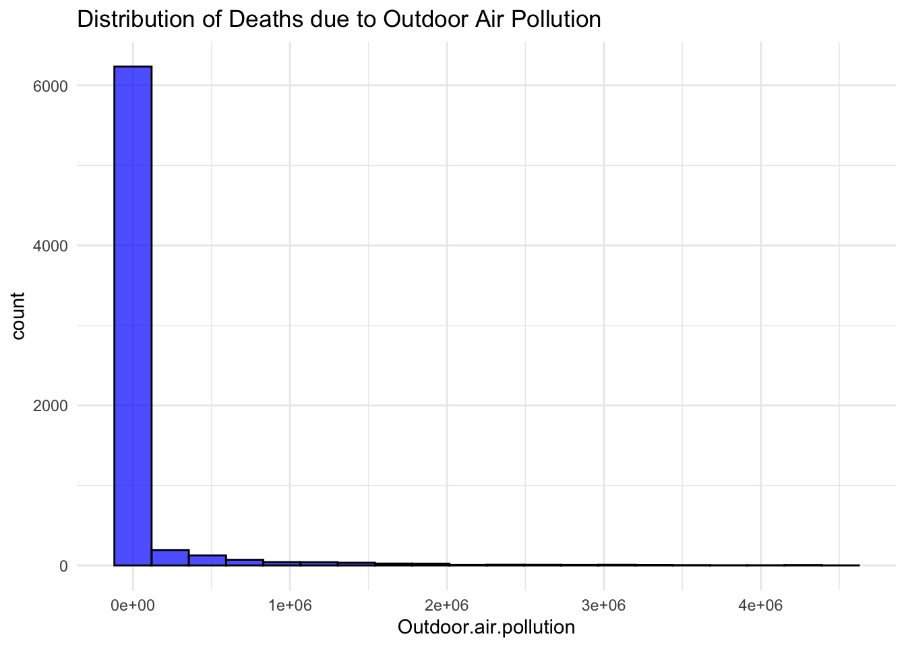
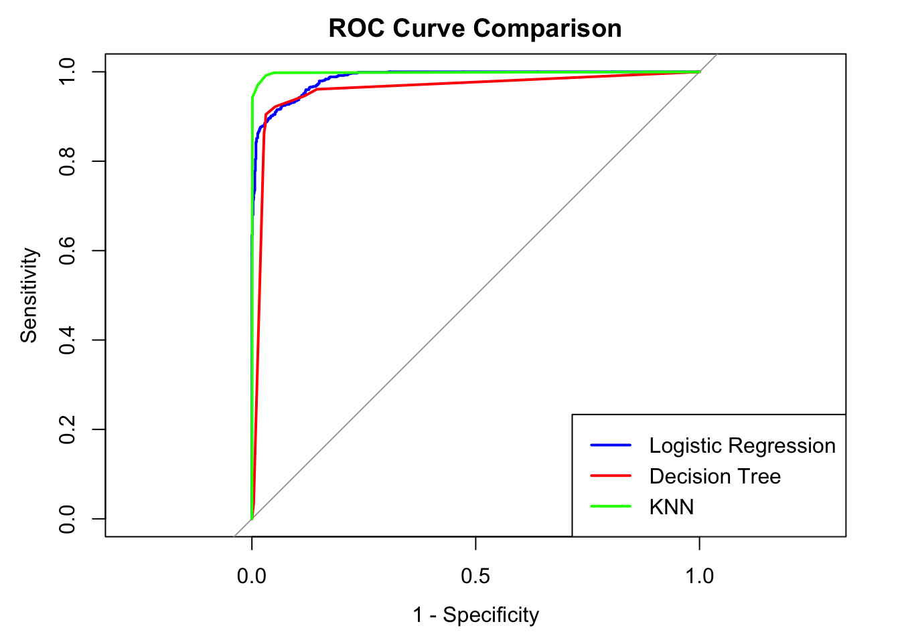
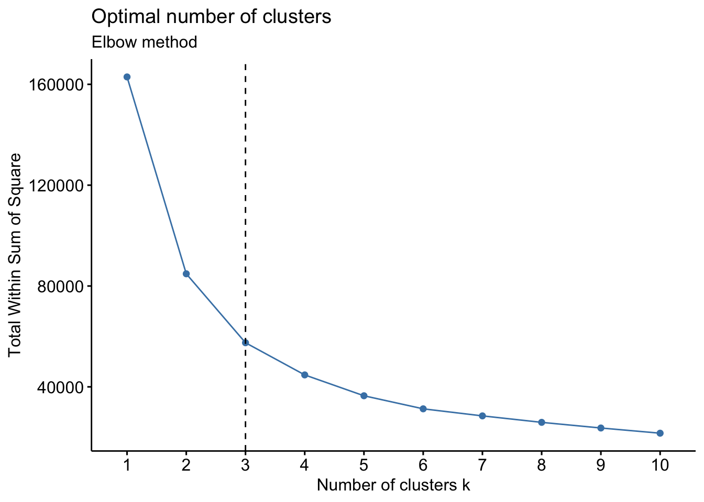
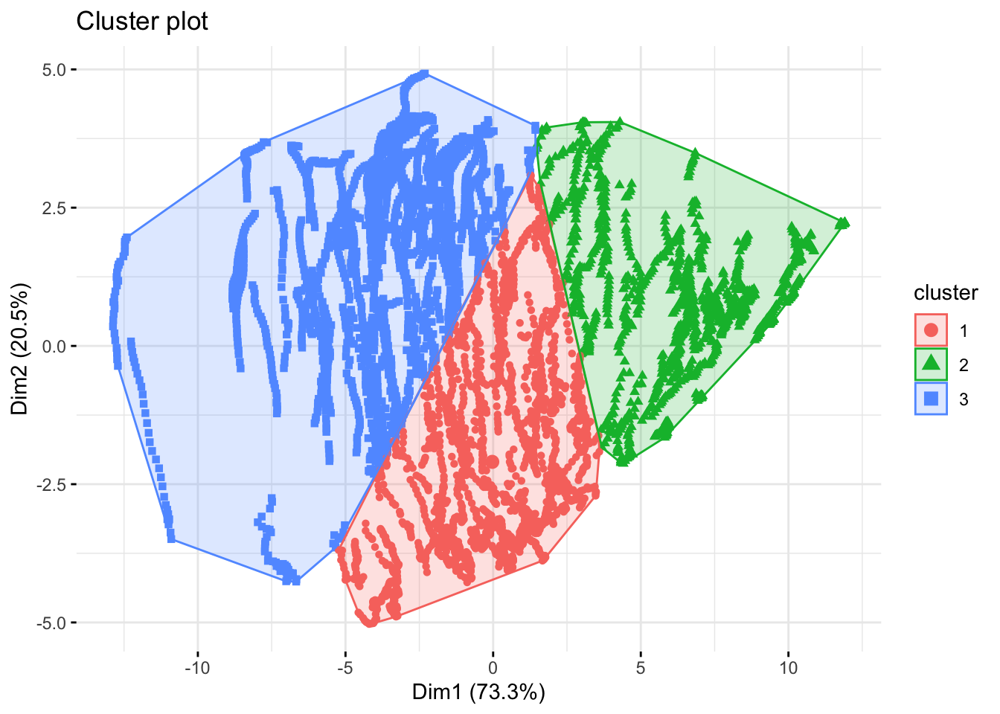

# Global Causes of Death: Classification and Clustering in R

An end-to-end analysis in R of deaths from 28 risk factors (such as air pollution, high blood pressure, smoking and diet) across countries from 1990 onwards. It covers data cleaning, transformation, classification with three models, explainability with LIME, K-means clustering, and an interactive **Shiny app** to explore the results.

**Video walkthrough:** <https://youtu.be/KlV3De7Bn7I>

## The question

Can we tell which country-years have a **high number of deaths from high systolic blood pressure**, the most frequent leading cause of death in the data, from the deaths attributed to other risk factors? And do countries fall into natural groups based on their pattern of deaths?

## Approach

**1. Data cleaning**
- The raw data has 6,840 rows and 31 columns.
- Rows with no country code turned out to be regions and territories, not countries. These were removed, along with aggregates such as "World", leaving valid countries only.

**2. Transformation**
- Death counts are extremely right-skewed: a few large countries dominate. Log transformation and Z-score normalisation put all features on a comparable scale.



**3. Target and features**
- The target is a binary label: whether a country-year's deaths from high systolic blood pressure are above the mean.
- Features were chosen with a correlation matrix, then refined with **LIME** explanations into a second feature set.

**4. Classification**
- A null model, then single-variable logistic models ranked by AUC.
- Three multi-variable models: **logistic regression**, a **decision tree** (CART), and **K-nearest neighbours**.
- Each model was tested on a 70/30 split and tuned with 10-fold cross-validation.

**5. Clustering**
- K-means on the standardised features. The elbow method and NbClust both chose **3 clusters**.

## Results

| Model | Test accuracy | 10-fold CV accuracy |
|---|---|---|
| Null model (always the majority class) | 44.2% | |
| Best single-variable logistic model | 81.5% | |
| Logistic regression | 87.9% | |
| Decision tree (CART) | 93.4% | 96.4% (tuned) |
| KNN (k = 5) | | 98.6% |
| **KNN with LIME-selected features** | **97.9%** | |



KNN performed best overall. Using the features LIME identified as most important gave a small further improvement over the original feature set (97.9% vs 97.8%).

**Clustering:** the three clusters separate clearly on the first two principal components, which together explain 93.8% of the variance.

 

## Interactive Shiny app

`app.R` is a Shiny dashboard with four tabs:
1. **Cause of death trends:** explore the top or bottom countries for any cause of death, or the causes for one country or region.
2. **Single-variable models:** ROC curves and a model summary for selected variables.
3. **Multi-variable models:** ROC curves and a comparison table for logistic regression, the decision tree and KNN.
4. **Clustering results:** the K-means clusters.

## Reflections and next steps

Looking back, two things would make the results more trustworthy:
- **Use rates, not counts.** The data holds total deaths, which grow with population size. That is why the features are so strongly correlated with each other and with the target. Converting to deaths per 100,000 people would test whether the models learn health patterns rather than country size.
- **Split by country, not by row.** Each country appears once per year, so a random split puts near-identical years of the same country in both training and test sets. Holding out whole countries would give a fairer estimate of accuracy.

## Files

```
causes_of_death_analysis.Rmd       full analysis (R Markdown)
app.R                              interactive Shiny app
data/countries_and_death_causes.csv  dataset (6,840 rows, 31 columns)
images/                            figures used in this README
```

## How to run

1. Install R and RStudio, then the packages:
   ```r
   install.packages(c("ggplot2","dplyr","tidyr","corrplot","GGally","gridExtra","gt","knitr","scales",
                      "car","caret","caTools","class","rpart","rpart.plot","pROC","lime",
                      "cluster","fpc","factoextra","NbClust","shiny","shinyWidgets"))
   ```
2. Open the project folder in RStudio, so the `data/` path works.
3. **Analysis:** open `causes_of_death_analysis.Rmd` and click **Knit**.
4. **App:** open `app.R` and click **Run App**.

## Tools

R, R Markdown, Shiny, ggplot2, dplyr, caret, rpart, KNN (class), pROC, LIME, cluster, factoextra, NbClust

## Author

Muneef Muhammed, Master of Data Science, University of Western Australia
[Portfolio](https://muneef97.github.io) · [LinkedIn](https://www.linkedin.com/in/muneef-muhammed/)
